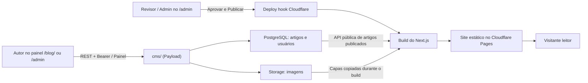

# Decisões de arquitetura — GNUverse

Decisões técnicas iniciais de 14/10/2026; escopo e estado atualizados em 15/11/2026.

## Produto e autoria

- Nome: GNUverse.
- Tema: software livre como forma de democratizar o acesso à tecnologia.
- Duas áreas independentes: [jogo de torres colaborativas](torres-colaborativas.md) e [blog autoral moderado](blog.md). Posts não são salas nem dependem do jogo.
- Blog aberto a contribuições mediante autorização, com 14 posts iniciais da equipe (dois por integrante). O fluxo editorial (`author`/`reviewer`/`admin`), o painel público de submissão em `/blog/` e a aprovação obrigatória já estão implementados no código; os serviços na nuvem, SMTP e os 14 posts ainda estão pendentes.
- Manter Next.js App Router, Tailwind e TypeScript.
- Os sete integrantes e colaboradores externos preparam conteúdo; pesquisa, argumentação, entrevistas, experiências e revisão continuam humanas.

## Hospedagem e conteúdo

- CMS escolhido para esta implementação: Payload, hospedado por nós na nuvem, separado do site público.
- O site público é exportado como HTML/CSS/JS e hospedado no Cloudflare Pages. Artigos e capas já chegam prontos ao visitante, mesmo com o CMS suspenso.
- CMS previsto no Render Free; PostgreSQL e armazenamento de imagens previstos no Supabase. Estes serviços ainda não foram criados/configurados nesta tarefa.
- Publicar no CMS dispara um deploy hook do Cloudflare. O build consulta apenas artigos publicados, copia as capas e gera uma nova versão do site.
- Conteúdo vai ao banco e imagens ao storage. Edições pelo CMS não criam commits no Git. Código, modelos dos campos e migrações continuam versionados.
- O **leitor** do blog não consulta a API do CMS (leitura 100% estática de `out/`). Já o painel opcional de submissão editorial em `/blog/` comunica-se diretamente do navegador com a API do CMS via `NEXT_PUBLIC_CMS_URL`, motivo pelo qual o Payload configura `CORS`/`CSRF` por `CMS_ALLOWED_ORIGINS`.

## Fluxo

## Implementação atual

- `cms/` é uma segunda aplicação com dependências e build próprios. O site público permanece na raiz.
- Painel em `/admin`, artigos em `/api/articles`, usuários em `/api/users` e mídia em `/api/media`.
- Papéis próprios:
  - `admin`: cria/gerencia integrantes, mídias e artigos;
  - `reviewer`: revisa submissões, registra `reviewNotes`, aprova, publica, despublica e exclui artigos;
  - `author`: cria e edita apenas os próprios artigos em `draft` ou `changes_requested`, podendo enviar para revisão (`reviewStatus: 'in_review'`), mas bloqueado na API e no painel de publicar diretamente (`_status: 'published'`) ou editar documentos de terceiros.
- Cadastro público de autores (`POST /api/users`) atribui obrigatoriamente `role: 'author'` quando não há usuário autenticado (mantendo o bootstrap de `admin` apenas quando `users` está vazio).
- Campos editoriais de controle: `owner` (preenchido no servidor com o usuário criador), `reviewStatus` (`draft`, `in_review`, `changes_requested`, `approved`) e `reviewNotes` (restrito a revisores/admin/autor dono; oculto da leitura pública anônima).
- API anônima permite ler artigos publicados; rascunhos novos, edições ainda não publicadas, usuários e notas de revisão ficam fora da API pública.
- Primeiro integrante criado no painel recebe papel de administrador. Preparar o primeiro usuário antes de divulgar o endereço do CMS.
- Imagens têm descrição acessível e crédito obrigatórios. A biblioteca de imagens é pública, incluindo imagens ainda não usadas; somente material destinado à publicação deve ser enviado.
- Editor visual para o corpo no `/admin`, conversão de parágrafos simples para Lexical no envio por `/blog/`, capa opcional e referências estruturadas. Uploads no corpo e links internos de relacionamentos foram retirados para evitar dependências do CMS durante a leitura do visitante.
- Sem recuperação de senha por e-mail configurada ainda (`SMTP` é uma pendência antes da abertura ampla a visitantes externos).

## Local e nuvem

Localmente, SQLite e uploads locais permitem experimentar sem conta externa. `npm run cms:setup` cria um segredo aleatório em arquivo ignorado, preservando uma configuração já existente. No `make dev`, `scripts/dev.ts` repassa `CMS_ALLOWED_ORIGINS` (incluindo `localhost` e `127.0.0.1` na `SITE_PORT`) para o CMS e `NEXT_PUBLIC_CMS_URL` para o site.

Na nuvem, a configuração bloqueia o uso de SQLite/disco local em produção: PostgreSQL e S3 são obrigatórios para não perder conteúdo em reinícios do Render. O adaptador S3 é compatível com o endpoint de Storage do Supabase. As migrações de PostgreSQL estão versionadas em `cms/src/migrations/`.

O modo `demo` usa um artigo identificado como exemplo, em `content/demo-article.json`. O modo `live` usa exclusivamente a API do CMS. Nenhum conteúdo demo é usado silenciosamente se o CMS falhar.

O snapshot `.content/` e as capas em `public/cms-media/` são gerados e ignorados pelo Git. Não colocar credenciais em variáveis `NEXT_PUBLIC_*`: `NEXT_PUBLIC_CMS_URL` e `NEXT_PUBLIC_GAME_API_URL` contêm apenas URLs públicas de API (sem chaves de banco, storage, deploy hook ou tokens).

## Limitações aceitas

- O CMS gratuito pode suspender. O primeiro acesso ao painel, ao build ou ao painel de submissão em `/blog/` pode demorar (o cliente usa timeout de 120 s e avisa sobre a espera no Render Free); o leitor dos artigos publicados não depende dessa inicialização.
- Um build pode esperar até 120 segundos por uma chamada ao CMS. Se falhar, o deploy não deve substituir a versão anterior. Não é garantido que todo cold start caiba nesse intervalo.
- Mudanças só aparecem após um deploy bem-sucedido. Até lá, a versão anterior permanece pública, inclusive um artigo recém-despublicado. Para retirada urgente, é necessário confirmar o deploy/retirar a versão hospedada.
- O hook é acionado por publicação, edição publicada, despublicação e exclusão publicada. Salvar rascunho ou enviar para revisão não dispara build. Não há fila persistente ou retry automático do hook: uma falha fica nos logs e exige deploy manual.
- Cada publicação pode gerar um build; combinar revisões antes de publicar. O plano gratuito do Cloudflare tem quotas, incluindo builds.
- Editar uma imagem na biblioteca não dispara build sozinho nesta versão. Republicar os artigos afetados. Capas geradas sem uso são removidas na sincronização seguinte.
- Configuração de nuvem, conexão real com Supabase/S3 e disparo de um deploy hook real dependem das contas e credenciais do usuário. Não foram comprovados por testes locais.
- A exportação estática sozinha não oferece cadastro público, moedas, votos ou persistência multiplayer. Por isso, o jogo usa um backend Node dedicado (`game-server/`) e o blog usa a API do Payload para submissões de autores; os dois sistemas de contas são separados.

## Referências técnicas

- [Next.js: exportação estática](https://nextjs.org/docs/app/guides/static-exports).
- [Payload: instalação](https://payloadcms.com/docs/getting-started/installation), [deploy](https://payloadcms.com/docs/production/deployment), [storage](https://payloadcms.com/docs/upload/storage-adapters).
- [Render Free](https://render.com/docs/free) e [Supabase Free](https://supabase.com/pricing).
- [Supabase: credenciais S3](https://supabase.com/docs/guides/storage/s3/authentication).
- [Cloudflare: deploy hooks](https://developers.cloudflare.com/pages/configuration/deploy-hooks/).

## Configuração local de porta

`CMS_PORT` no `.env.local` da raiz é a fonte única da porta do CMS. O valor inicial vem de `.env.example`; não há fallback numérico nos scripts. `make dev`, `make cms`, o Payload e `make sync` derivam o endereço local dessa variável. A variável de shell pode sobrescrever o arquivo para uma execução. Em produção, configurar `CMS_URL`, `NEXT_PUBLIC_CMS_URL` no site e `CMS_SERVER_URL` / `CMS_ALLOWED_ORIGINS` no CMS, pois são aplicações hospedadas separadamente.

## Separação entre blog e jogo

O fluxo acima descreve a publicação e submissão editorial do blog. Ações no jogo não disparam deploy hooks nem geram commits Git. O backend do jogo (`game-server/` em `node:http`, `node:sqlite`, `matter-js` e SSE) **já está implementado localmente** e inicia junto com CMS e site em `make dev`; falta apenas escolher e configurar sua hospedagem contínua com volume persistente em produção. Não assumir que o servidor gratuito com suspensão escolhido para o CMS responde às necessidades de uma partida.

A separação entre `author`, `reviewer` e `admin` e o painel de submissão pública em `/blog/` já estão implementados, mantendo a política editorial do blog independente do modelo BDFL ou dos banimentos de uma torre.
