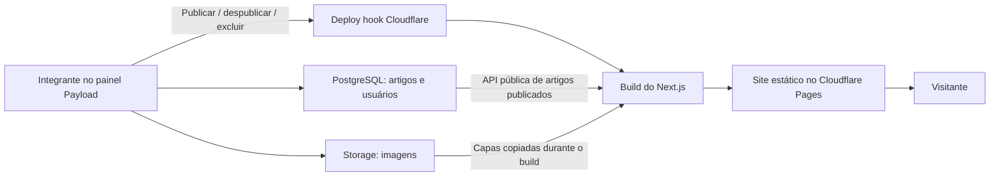

# Decisões de arquitetura — GNUverse

Decisões registradas em 14/10/2026.

## Produto e autoria

- Nome: GNUverse.
- Tema: software livre como forma de democratizar o acesso à tecnologia.
- Estrutura editorial semelhante a uma revista/blog, com artigos autorais e experiências interativas desenvolvidas aos poucos.
- Manter Next.js App Router, Tailwind e TypeScript.
- Os sete integrantes alimentam conteúdo pelo painel; pesquisa, argumentação, entrevistas, experiências e revisão continuam humanas.

## Hospedagem e conteúdo

- CMS escolhido para esta implementação: Payload, hospedado por nós na nuvem, separado do site público.
- O site público é exportado como HTML/CSS/JS e hospedado no Cloudflare Pages. Artigos e capas já chegam prontos ao visitante, mesmo com o CMS suspenso.
- CMS previsto no Render Free; PostgreSQL e armazenamento de imagens previstos no Supabase. Estes serviços ainda não foram criados/configurados nesta tarefa.
- Publicar no CMS dispara um deploy hook do Cloudflare. O build consulta apenas artigos publicados, copia as capas e gera uma nova versão do site.
- Conteúdo vai ao banco e imagens ao storage. Edições pelo CMS não criam commits no Git. Código, modelos dos campos e migrações continuam versionados.
- O visitante não consulta a API do CMS. A URL do CMS não precisa de CORS para leitura pelo servidor de build.

## Fluxo

## Implementação atual

- `cms/` é uma segunda aplicação com dependências e build próprios. O site público permanece na raiz.
- Painel em `/admin`, artigos em `/api/articles` e mídia em `/api/media`.
- Papéis próprios: administrador cria/gerencia integrantes; editor escreve, edita, publica e exclui artigos. Nesta versão todos os editores colaboram em todos os artigos. Não há aprovação editorial obrigatória ainda.
- API anônima permite ler artigos publicados; não permite criar/editar conteúdo, ler integrantes ou consultar versões. Rascunhos novos e edições ainda não publicadas ficam fora da API pública.
- Primeiro integrante criado no painel recebe papel de administrador. Preparar o primeiro usuário antes de divulgar o endereço do CMS. Os demais são criados pelo administrador como editores.
- Imagens têm descrição acessível e crédito obrigatórios. A biblioteca de imagens é pública, incluindo imagens ainda não usadas; somente material destinado à publicação deve ser enviado.
- Editor visual para o corpo, capa opcional e referências estruturadas. Uploads no corpo e links internos de relacionamentos foram retirados desta versão para evitar dependências do CMS durante a visita.
- Sem recuperação de senha por e-mail configurada. Para o piloto, criar credenciais e trocar senha no painel; SMTP é uma etapa futura.

## Local e nuvem

Localmente, SQLite e uploads locais permitem experimentar sem conta externa. `npm run cms:setup` cria um segredo aleatório em arquivo ignorado, preservando uma configuração já existente.

Na nuvem, a configuração bloqueia o uso de SQLite/disco local em produção: PostgreSQL e S3 são obrigatórios para não perder conteúdo em reinícios do Render. O adaptador S3 é compatível com o endpoint de Storage do Supabase. A migração inicial de PostgreSQL está em `cms/src/migrations/`.

O modo `demo` usa um artigo identificado como exemplo, em `content/demo-article.json`. O modo `live` usa exclusivamente a API do CMS. Nenhum conteúdo demo é usado silenciosamente se o CMS falhar.

O snapshot `.content/` e as capas em `public/cms-media/` são gerados e ignorados pelo Git. Não colocar credenciais em variáveis `NEXT_PUBLIC_*`: o site público não precisa de chaves de banco, storage ou login do CMS.

## Limitações aceitas

- O CMS gratuito pode suspender. O primeiro acesso ao painel ou ao CMS durante um build pode demorar; o visitante do site publicado não depende dessa inicialização.
- Um build pode esperar até 120 segundos por uma chamada ao CMS. Se falhar, o deploy não deve substituir a versão anterior. Não é garantido que todo cold start caiba nesse intervalo.
- Mudanças só aparecem após um deploy bem-sucedido. Até lá, a versão anterior permanece pública, inclusive um artigo recém-despublicado. Para retirada urgente, é necessário confirmar o deploy/retirar a versão hospedada.
- O hook é acionado por publicação, edição publicada, despublicação e exclusão publicada. Salvar apenas rascunho novo não exige build. Não há fila persistente ou retry automático do hook: uma falha fica nos logs e exige deploy manual.
- Cada publicação pode gerar um build; combinar revisões antes de publicar. O plano gratuito do Cloudflare tem quotas, incluindo builds.
- Editar uma imagem na biblioteca não dispara build sozinho nesta versão. Republicar os artigos afetados. Capas geradas sem uso são removidas na sincronização seguinte.
- Configuração de nuvem, conexão real com Supabase/S3 e disparo de um deploy hook real dependem das contas e credenciais do usuário. Não foram comprovados por testes locais.
- Exportação estática não terá contas de visitantes, respostas persistidas ou funções de servidor público. Interações no navegador continuam possíveis.

## Referências técnicas

- [Next.js: exportação estática](https://nextjs.org/docs/app/guides/static-exports).
- [Payload: instalação](https://payloadcms.com/docs/getting-started/installation), [deploy](https://payloadcms.com/docs/production/deployment), [storage](https://payloadcms.com/docs/upload/storage-adapters).
- [Render Free](https://render.com/docs/free) e [Supabase Free](https://supabase.com/pricing).
- [Supabase: credenciais S3](https://supabase.com/docs/guides/storage/s3/authentication).
- [Cloudflare: deploy hooks](https://developers.cloudflare.com/pages/configuration/deploy-hooks/).

## Configuração local de porta

`CMS_PORT` no `.env.local` da raiz é a fonte única da porta do CMS. O valor inicial vem de `.env.example`; não há fallback numérico nos scripts. `make dev`, `make cms`, o Payload e `make sync` derivam o endereço local dessa variável. A variável de shell pode sobrescrever o arquivo para uma execução. Em produção, configurar `CMS_URL` no site e `CMS_SERVER_URL` no CMS, pois são aplicações hospedadas separadamente.
