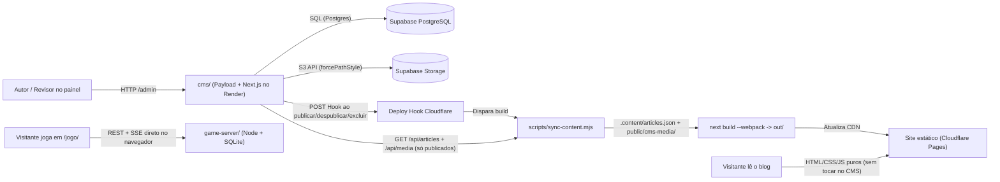

# 1. Visão geral da arquitetura (para quem programa em C e Node)

O GNUverse não é um monolito único. Ele é composto por **3 programas independentes** (3 processos distintos de sistema operacional, sem memória compartilhada, conversando apenas por HTTP/JSON e SSE):

| Programa | Pasta / Runtime | Onde roda em produção | Papel |
|---|---|---|---|
| **Site estático** | Raiz (`src/`), Next.js `16.4.1` com `output: "export"` | **Cloudflare Pages** (CDN estática) | Compila HTML, CSS e JS puros para `out/` na hora do build |
| **CMS (Blog Admin/API)** | `cms/`, Next.js + Payload CMS `3.90.2` | **Render Free** (processo Node contínuo, pode dormir) | Painel `/admin` e API REST (`/api/articles`, `/api/media`, `/api/users`) |
| **Game Server** | `game-server/`, Node `>= 22.18` puro (`node:http` + `node:sqlite`) | **Pendente** (precisa de disco persistente e ficar sempre ligado) | Autoridade do jogo, auth de jogadores, física (`matter-js`) e SSE |

### Tradutor rápido (C / Node → termos deste repositório)

- **TypeScript (`.ts` / `.tsx`):** é só JavaScript com anotações de tipo (como `int` ou `struct`). `tsc --noEmit` apenas checa esses tipos estaticamente; o Node `>= 22.18` executa `.ts` direto descartando os tipos em tempo de carga.
- **React / JSX (`.tsx`):** função JS que recebe parâmetros (`props`) e retorna HTML com `{expressões}` dentro.
- **CDN estática (Cloudflare Pages):** servidor HTTP que entrega apenas os arquivos prontos da pasta `out/` — sem processo Node rodando.
- **SSE (*Server-Sent Events*):** conexão HTTP `GET` que o servidor mantém aberta para ir enviando eventos de texto só na direção servidor → navegador (como um `write()` contínuo no socket, sem *polling*).

---

## O modelo mental em C (a peça mais importante para entender o blog)

Se você vem de C e conhece backend Node simples, há **uma pegadinha clássica** no Next.js: normalmente as pessoas acham que o Next.js é um servidor Node rodando em produção. **Aqui na raiz do projeto ele NÃO é.**

Veja [next.config.ts](../../next.config.ts):

```ts
const nextConfig: NextConfig = {
  output: "export",
  trailingSlash: true,
  images: { unoptimized: true },
};
```

Com `output: "export"`, o Next.js da raiz funciona exatamente como um **compilador + linker estático** (como rodar um gerador de código que emite binários estáticos):

1. Antes de compilar (`prebuild` no [package.json](../../package.json)), o script [scripts/sync-content.mjs](../../scripts/sync-content.mjs) funciona como uma etapa de preparação de assets:
   - Faz `GET` na API pública do CMS (`${CMS_URL}/api/articles?where[_status][equals]=published...`).
   - Valida o JSON de cada artigo em [scripts/cms-content.mjs](../../scripts/cms-content.mjs) (se falhar, retorna erro e aborta o build, como um erro de compilação).
   - Baixa cada imagem de capa e salva em `public/cms-media/<sha256>.<ext>`.
   - Grava o snapshot em `.content/articles.json`.
2. Em seguida, `next build --webpack` lê `.content/articles.json` via [src/lib/articles.ts](../../src/lib/articles.ts) e gera **arquivos estáticos puros** na pasta `out/` (`out/blog/index.html`, `out/artigos/ola-gnuverse/index.html`, etc.).
3. Em produção (Cloudflare Pages), **não existe nenhum processo Node rodando para o site**. Só arquivos estáticos servidos por HTTP.

### Consequência direta para o que você vai programar no blog

- **Você NÃO pode colocar endpoints `/api/...` nem lógica secreta de servidor dentro de `src/app/`.** Tudo em `src/app/` que lê disco (como `fs/promises` em `articles.ts`) roda **apenas na máquina de build**, nunca durante a visita do usuário.
- **Qualquer coisa dinâmica depois que o site foi publicado** (login, salvar rascunho, enviar artigo de visitante, subir imagem) **tem que ir para um processo servidor de verdade** — ou seja, para o `cms/` (Payload no Render) ou para um serviço externo, nunca para o Next.js da raiz.
- **Variáveis `NEXT_PUBLIC_*` são como `#define` em tempo de compilação:** o bundler substitui o valor literalmente dentro do `.js` que vai para o navegador do usuário. Nunca coloque senhas, tokens ou segredos em `NEXT_PUBLIC_*`.

---

## Fluxo ponta a ponta



Pontos-chave desse desenho:
- **Leitor do blog nunca toca no CMS:** mesmo se o Render Free estiver dormindo (cold start), o leitor abre `/blog/` e `/artigos/<slug>/` instantaneamente pelo Cloudflare Pages.
- **Ações do jogo não disparam build do site:** `/jogo/` é uma página estática que carrega React no navegador e abre conexões HTTP/SSE direto contra `NEXT_PUBLIC_GAME_API_URL`.
- **`cms/` é um segundo projeto completo:** ele tem seu próprio [cms/package.json](../../cms/package.json), seu próprio `node_modules/`, e roda `next start --hostname 0.0.0.0` em produção (ou seja, o CMS **é** um servidor Node dinâmico).
- **Node executando `.ts` direto:** o projeto usa Node `>= 22.18.0` (neste ambiente, `v26.13.0`), que consegue rodar arquivos `.ts` diretamente via *type stripping* nativo (por exemplo `node game-server/index.ts` e `node scripts/dev.ts`). O `tsc --noEmit` serve só como checagem estática de tipos (equivalente a rodar compilação com `-fsyntax-only` / análise estática).

---

## Como `make dev` sobe os 3 processos localmente

Ao executar `make dev` (definido no [Makefile](../../Makefile)), ele chama `node scripts/dev.ts` ([scripts/dev.ts](../../scripts/dev.ts)):

1. Lê portas de `.env.local` (ou variáveis de ambiente): `SITE_PORT` (`3000`), `CMS_PORT` (`3001`), `GAME_PORT` (`3002`), validando em [scripts/dev-config.ts](../../scripts/dev-config.ts) que são 3 portas distintas.
2. Faz `spawn` em paralelo de dois processos filhos (em grupos de processo separados no Linux para poder matar tudo no `Ctrl+C`):
   - `npm run cms:dev` (CMS na `CMS_PORT`)
   - `npm run game:dev` (Game Server na `GAME_PORT`, com `GAME_ALLOWED_ORIGINS` incluindo `localhost:SITE_PORT` e `127.0.0.1:SITE_PORT`)
3. Fica em loop de *polling* HTTP (`waitForAPI`, timeout de 180 s) esperando:
   - `GET http://localhost:3001/api/articles?limit=1` responder JSON com array `docs`.
   - `GET http://localhost:3002/api/health` responder `{ ok: true }`.
4. Só depois que os dois backends estão de pé é que ele inicia `npm run dev -- --webpack --port 3000`, injetando `CMS_CONTENT_MODE=live`, `CMS_URL` e `NEXT_PUBLIC_GAME_API_URL` no ambiente do filho (disparando `predev` -> `sync-content.mjs` na inicialização).

---

## Nota sobre documentação no repositório

Os documentos principais de `docs/` ([README.md](../../README.md), [arquitetura-cms.md](../arquitetura-cms.md), [planejamento.md](../planejamento.md), [blog.md](../blog.md), [arquitetura-jogo.md](../arquitetura-jogo.md) e [jogo-local.md](../jogo-local.md)) já refletem o `game-server/` funcional localmente e o fluxo editorial com papéis `author`, `reviewer` (`editor` mantido como alias legado) e `admin`.
