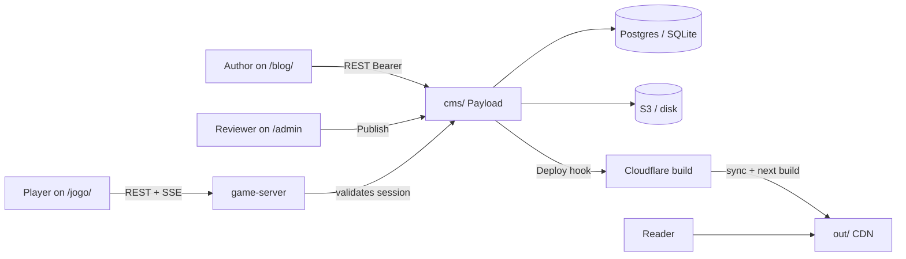

# Repository map

Three distinct processes (no shared memory; they talk over HTTP/JSON and SSE):

| Program | Folder | Production | Role |
| :--- | :--- | :--- | :--- |
| Static site | root (`src/`), Next.js `output: "export"` | Cloudflare Pages | HTML/CSS/JS in `out/` |
| CMS | `cms/`, Payload | Render Free (may sleep) | `/admin`, `/acessos`, `/moderacao-chat`, `/api/articles`, `/api/users`, `/api/media` |
| Game server | `game-server/` | Always-on host + disk (pending) | Player auth via CMS, Open Pipeline grid tick, SSE |

## Main folders

**`src/`** — Site App Router (`/`, `/blog/`, `/artigos/`, `/jogo/`), components, and static-read libs.

**`cms/`** — Second app (own `package.json`). Collections, access, PostgreSQL migrations, deploy hook.

**`game-server/`** — Plain Node backend; SQLite state + in-memory Open Pipeline match (`pipeline/`).

**`core/`** — Pure policies: `core/authz/` (roles/permissions) and `core/authn/` (identity contract).

**`scripts/`** — `dev.ts`, `sync-content.mjs`, `test-blog.ts`, site setup.

**`docs/`** — this book (`make docs-serve`).

**`content/demo-article.json`** — demo article for `demo` mode; not inserted into the DB automatically.

## How `make dev` starts everything

1. Reads `SITE_PORT` (3000), `CMS_PORT` (3001), `GAME_PORT` (3002) from `.env.local`.
2. Starts `cms:dev` and `game:dev`.
3. Waits for `GET /api/articles?limit=1` and `GET /api/health`.
4. Starts the site with `CMS_CONTENT_MODE=live`, `CMS_URL`, and `NEXT_PUBLIC_GAME_API_URL`.

`make setup` installs dependencies, writes `cms/.env` (random secret, local SQLite), and creates `.env.local` with `CMS_CONTENT_MODE=live`.

## Static export caveat

With `output: "export"`, the root app is **not** a Node server in production. Disk reads and `src/lib/articles.ts` run only at build time. Login, drafts, uploads, and admin go to `cms/` or `game-server/`. `NEXT_PUBLIC_*` values become literals in the bundle — never put secrets there.



## Useful commands

```bash
make setup          # first time
make dev            # CMS + game + site
make cms-seed       # demo users, covers, and articles in the local CMS
make cms-reset      # wipe local CMS SQLite DB and media
make cms-fresh      # reset local CMS, then seed
make test-blog      # seed + E2E + browser
make check          # tests + typecheck
make build          # sync + out/
make preview        # serve out/ without CMS
make docs-serve     # this book
```
